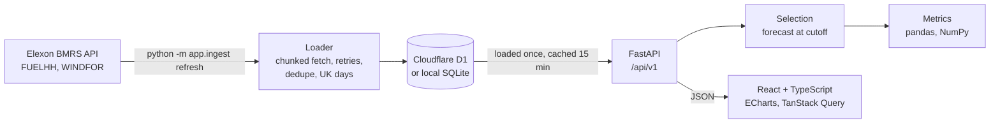

# WindDesk: day-ahead wind forecast monitor

[](https://github.com/PrajyotMane01/p4eumrwqm53s7ah8/actions/workflows/ci.yml)

A web app for a UK utility's day-ahead trading team. It shows the GB national wind forecast that was actually available when the buying decision had to be made, and measures how accurate those forecasts were against metered output.

**Live app: https://p4eumrwqm53s7ah8.vercel.app** ([Accuracy view](https://p4eumrwqm53s7ah8.vercel.app/?view=accuracy))

Scope, as set by the brief: national wind only, from two Elexon BMRS datasets ([FUELHH](https://bmrs.elexon.co.uk/api-documentation/endpoint/datasets/FUELHH/stream) actuals with `fuelType = WIND`, and [WINDFOR](https://bmrs.elexon.co.uk/api-documentation/endpoint/datasets/WINDFOR/stream) forecasts), for purchase decisions made in January 2026.

## What the app does

**Day-ahead view.** For every half-hour of a delivery day, it shows actual wind generation against the forecast a trader would have had at the decision cutoff. Stat cards summarise the range, and the chart's tooltip shows when the selected forecast was published and how far ahead it was made.

**Accuracy view.** It shows MAE, bias, RMSE, P10/P50/P90 error and the share of half-hours that were over-forecast, plus a plain-language buying summary. Charts break the error down by error size, by forecast wind level and by hour of day. A worst-days table links each day back to the Day-ahead view.

Both views share the filters for date range and cutoff. Filters live in the URL, so any view can be bookmarked or shared, for example `?view=accuracy&start=2026-01-10&end=2026-01-20&cutoff=09:20`.

### Findings for January 2026 (09:50 cutoff)

| Measure | Value |
| --- | --- |
| Mean absolute error | 2,086 MW (18.3% of mean actual) |
| Bias (forecast − actual) | +1,809 MW; over-forecast in 85% of half-hours |
| P90 shortfall | 4,317 MW: in 9 of 10 half-hours, actual was at most this far below forecast |
| RMSE | 2,585 MW |
| Worst day | 28 Jan, MAE 5,375 MW |

The over-forecast grows with wind level, from about 3% when under 5 GW is forecast to about 23% above 20 GW. Actual output never exceeded 17.8 GW, while forecasts reached 21.3 GW. Elexon documents both datasets as covering metered wind farms, so a coverage mismatch is not the explanation. The pattern is consistent with curtailment at high output, but these two datasets cannot confirm it. For a trader, the practical point is the same: at high wind, plan for less than the forecast.

## Key decisions

| Question | Decision | Why |
| --- | --- | --- |
| Which forecast counts? | For each half-hour of delivery day D, the latest WINDFOR run published **at or before the cutoff on D‑1** | That is what a trader had in hand when the decision was due |
| Default cutoff | **09:50 UK time on D‑1**, adjustable in the UI | Gate closure of the Nord Pool N2EX GB day-ahead auction ([Nord Pool](https://support.nordpoolgroup.com/support/solutions/articles/8000088463-about-the-n2ex-day-ahead-auction)) |
| Delivery day | UK calendar day, 00:00–24:00 UK time (46 or 50 half-hours on clock-change days) | Clearest for users; all times are shown in UK time |
| "Decisions made in January 2026" | Delivery days **1 Jan to 1 Feb 2026** | A decision on 31 Jan is for delivery on 1 Feb |
| Hourly forecasts vs half-hourly actuals | The forecast for hour H applies to both H:00 and H:30 | WINDFOR is hourly and FUELHH is half-hourly |
| Missing data | Kept as gaps and counted, never filled | So the error figures are honest |
| Error sign | **Forecast − actual**: positive means over-forecast | Over-forecast means the trader bought too little |
| Data access | Loaded from Elexon once, stored, then served from the database | The January data is fixed. Storing it makes requests fast, keeps the app working if Elexon is down, and makes joining forecasts to actuals simple |

## Architecture



- **Backend:** FastAPI (Python 3.12, async) with pandas and NumPy. The selection rule uses `pandas.merge_asof` to pick the latest run published at or before each cutoff.
- **Database:** Cloudflare D1 in production, or a local SQLite file. D1 is SQLite, so both use the same schema and SQL. Python talks to D1 over its HTTP API, with inserts batched under D1's 100-parameter limit.
- **Frontend:** React 19 + TypeScript (Vite), TanStack Query for data fetching and ECharts for charts. Filters are validated, clamped and normalised when read from the URL.
- **Deployment:** Vercel, with two [Services](https://vercel.com/docs/services) in one project: the Vite static site, and FastAPI as a Python function under `/api`.

### API

Interactive docs are at `/docs` when running locally.

| Route | Returns |
| --- | --- |
| `GET /api/v1/health` | API and database status |
| `GET /api/v1/coverage` | First and last complete delivery days stored, when data was last loaded, the default cutoff |
| `GET /api/v1/series?start=&end=&cutoff=` | Actual and selected forecast per half-hour, with publish time and lead time |
| `GET /api/v1/metrics?start=&end=&cutoff=` | Summary error figures, histogram, by hour, by forecast level, worst days |

`start` and `end` are UK delivery days (both included, up to 62 days). `cutoff` is `HH:MM` UK time on the day before delivery. Invalid input returns 422; a database problem returns 503.

## Run it

### With Docker (recommended)

```bash
docker compose up --build
```

- App: http://localhost:8080
- API: http://localhost:8000/api/v1/health (docs at http://localhost:8000/docs)

On first start, the backend loads the January 2026 data from Elexon into a local SQLite database if it is empty (about 10 seconds), then starts serving. No account or configuration is needed.

### Locally, without Docker

Requires [uv](https://docs.astral.sh/uv/) and Node.js 22.

```bash
# Backend: http://localhost:8000
cd backend
cp .env.example .env                    # defaults to a local SQLite file
uv sync
uv run python -m app.ingest refresh     # load January 2026 from Elexon
uv run uvicorn app.main:app --reload --port 8000
```

```bash
# Frontend: http://localhost:5173 (proxies /api to the backend)
cd frontend
npm install
npm run dev
```

### Tests and checks

```bash
cd backend && uv run pytest && uv run ruff check . && uv run ruff format --check .
cd frontend && npm test && npm run lint && npm run build
```

[GitHub Actions](.github/workflows/ci.yml) runs all of these, plus a Docker build of both images, on every push to `main` or `dev` and on pull requests. The tests need no network or secrets.

## Data loading

```bash
cd backend
uv run python -m app.ingest refresh                                     # default: delivery days 2026-01-01 to 2026-02-01
uv run python -m app.ingest refresh --start 2026-03-01 --end 2026-03-08 # any range of UK delivery days (end exclusive)
uv run python -m app.ingest refresh --if-empty                          # only if the database has no data yet
uv run python -m app.ingest migrate                                     # create tables only
```

- **Chunked fetching:** requests to Elexon go in 7-day chunks. Rate limits, server errors and network errors are retried up to 3 times.
- **Cleaning:** only wind rows are kept. Revisions of an actual keep the latest publish. Forecast rows for times before their own publish time are dropped, because they are not forecasts.
- **Lookback:** forecast runs published up to 3 days before the range are included, so the first days still have day-ahead forecasts.
- **Safe to re-run:** everything is fetched before anything is written, then the range is replaced, so a re-run never duplicates rows and a failed fetch writes nothing. Each run is logged in `ingest_runs`.

## Configuration

Settings come from environment variables or `backend/.env` (see [`.env.example`](backend/.env.example)).

| Setting | Local SQLite | Cloudflare D1 |
| --- | --- | --- |
| `DB_BACKEND` | `sqlite` (default) | `d1` |
| Connection | `SQLITE_PATH` (default `data/wind.db`) | `CLOUDFLARE_ACCOUNT_ID`, `D1_DATABASE_ID` |
| Auth | none | `D1_AUTH=token` with `CLOUDFLARE_API_TOKEN` (needs D1 Edit), or `D1_AUTH=wrangler` to reuse a local `wrangler login` (development only) |

For Docker with `D1_AUTH=wrangler`, copy `compose.override.example.yaml` to `compose.override.yaml`. It is git-ignored and mounts the Wrangler login into the container.

## Deployment

The app is deployed on Vercel as one project with two services, configured in [`vercel.json`](vercel.json). Requests under `/api/*` go to FastAPI with the path unchanged; everything else goes to the static frontend. Production reads from Cloudflare D1, with `DB_BACKEND`, `D1_AUTH`, `CLOUDFLARE_ACCOUNT_ID`, `D1_DATABASE_ID` and `CLOUDFLARE_API_TOKEN` set in the Vercel project's environment variables.

```bash
npx vercel deploy --prod
```

[`.vercelignore`](.vercelignore) keeps `.env` files, local databases and build output out of uploads.

## Repository layout

| Path | Contents |
| --- | --- |
| `backend/` | FastAPI app (Python 3.12, managed with uv) |
| `backend/app/main.py` | App entry point and health route |
| `backend/app/api.py` | `/coverage`, `/series` and `/metrics` routes, with shared range checks |
| `backend/app/schemas.py` | Pydantic response models |
| `backend/app/analysis/selection.py` | The day-ahead rule: the forecast available at the cutoff, per half-hour, in UK delivery days |
| `backend/app/analysis/metrics.py` | Error figures, histogram, breakdowns, worst days |
| `backend/app/data_store.py` | In-memory copy of the stored data, refreshed every 15 minutes |
| `backend/app/db.py` | Database layer: local SQLite or Cloudflare D1 over HTTP |
| `backend/app/ingest/` | Loader: Elexon client (`elexon.py`), storage (`store.py`), refresh flow (`refresh.py`), command line (`__main__.py`) |
| `backend/app/wrangler_auth.py` | Development only: reuse and renew the Wrangler login for D1 |
| `backend/app/config.py` | Settings from environment variables or `.env` |
| `backend/migrations/` | SQL schema |
| `backend/tests/` | pytest: selection, metrics, loader, storage, API, config, auth (54 tests) |
| `backend/Dockerfile` | Backend image: loads data if empty, then runs uvicorn |
| `frontend/` | React + TypeScript app (Vite) |
| `frontend/src/App.tsx` | Layout and view switching |
| `frontend/src/components/` | Pages (`DayAheadPage`, `AccuracyPage`), charts (`EChart`, `SeriesChart`), sidebar, filters, cards |
| `frontend/src/lib/` | API client, URL state and filter validation, UK time helpers, formatting |
| `frontend/src/lib/filters.test.ts` | Vitest tests for URL filter handling (25 tests) |
| `frontend/Dockerfile`, `frontend/nginx.conf` | Frontend image: static build served by nginx, `/api` proxied to the backend |
| `compose.yaml` | Runs backend and frontend together in Docker |
| `compose.override.example.yaml` | Optional local override for using D1 through Wrangler in Docker |
| `vercel.json`, `.vercelignore` | Vercel deployment config |
| `.github/workflows/ci.yml` | CI: backend, frontend and Docker jobs |
| `Docs/` | Challenge brief and early tech-stack notes |

## Limitations and next steps

- **Fallback to live Elexon:** if the database is unavailable, fetch directly from Elexon. This is planned; today the app shows a clear error with a retry.
- **Curtailment:** the over-forecast at high wind cannot be confirmed with these two datasets alone. Curtailment data would explain it.
- **Freshness:** the API keeps data in memory for 15 minutes, so a refresh shows up after that.
- **Scheduled loading:** in production, the loader would run on a schedule, for example hourly, to pick up new forecast runs.
- **Bundle size:** the frontend bundle is about 800 KB, mostly ECharts, and could be split to load faster.

## Use of AI tools

This project was built with the help of [Claude Code](https://claude.com/claude-code), Anthropic's AI coding assistant. It was used for research (the Elexon datasets, the GB day-ahead gate closure, Vercel's Python support), writing code and tests, reviewing for bugs and edge cases, and drafting this README. Design decisions and choices about the domain (the cutoff time, delivery-day definition and data scope) were made by me, and the results were checked against raw Elexon data.
